  

  

  

  

&nbsp;

  

Profil 100 % SVG animé · aucune dépendance externe · rendu 3D précalculé · régénéré quotidiennement par <a href=".github/workflows/profile.yml">GitHub Actions</a>

